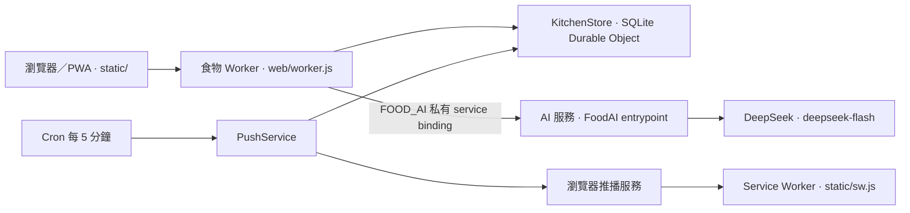

# Last Minute Bites

以減少食物浪費為目標的課程 Web／PWA prototype。使用者可管理食材批次與份量、共享廚房、生成 DeepSeek 食譜，並在聚會中整合已同意分享的食材。

目前版本：**1.4**（交接資訊更新：2026-11-10，香港時間）。

| 入口 | 連結／位置 |
| --- | --- |
| 正式 App | https://last-minute-bites-demo.jzalx789.workers.dev/ |
| 最新程式碼分支 | [`codex/last-minute-bites-prototype`](https://github.com/jzalx789/last-minute-bites/tree/codex/last-minute-bites-prototype) |
| AI coding assistant 指引 | [AGENTS.md](AGENTS.md) |
| 原始碼驗收 CI | [Prototype acceptance](https://github.com/jzalx789/last-minute-bites/actions/workflows/checks.yml) |
| 歷次驗證紀錄 | [docs/VALIDATION.md](docs/VALIDATION.md)（依日期閱讀，舊版本結果不是目前規格） |

**儲存庫已公開，組員可直接查看、下載或 clone 程式碼，請使用上列最新分支。** 向原儲存庫推送程式碼仍需協作者權限，也可透過 fork 提交 PR。公開的是程式碼，App 的帳戶與庫存仍受登入及廚房權限保護。

## 先認識這個專案

正式版本是 **原生 HTML／CSS／JavaScript + Cloudflare Worker + SQLite-backed Durable Object**，沒有 React、前端打包程序或外接 SQL 伺服器。`static/` 同源提供介面，`web/worker.js` 提供 `/api/*` 與 `/healthz`。

`server.py`、WSGI、舊部署工具和部分舊設計圖是早期版本保留的對照／回歸材料。**目前 AI、批次份量、多廚房與聚會功能以 `static/` 和 `web/` 為準**；啟動舊 Python server 不會得到完整正式功能。`design/README.md` 中的固定食譜設計也已被動態生成取代。



`web/ai-gateway.js` 定義 `FoodAI` RPC 類別，由正式環境的私有 AI 服務匯出。DeepSeek 金鑰只留在伺服器，瀏覽器與這個來源儲存庫不持有金鑰。本機開發改接測試 RPC，可以不用金鑰先跑完整操作流程。

## 本機啟動：Mac／Linux

使用 **Node.js 24**（與 CI 一致）、**Python 3.12**、Git。以下指令從儲存庫根目錄執行。公開原始碼的 `git clone` 不需登入；推送至原儲存庫仍需 GitHub 授權。

```sh
git clone --branch codex/last-minute-bites-prototype https://github.com/jzalx789/last-minute-bites.git
cd last-minute-bites
npm ci --prefix web
python3 -m venv .venv
source .venv/bin/activate
python -m pip install playwright==1.62.0 Pillow==13.0.0
python -m playwright install chromium webkit
```

Linux 若缺少瀏覽器系統套件，可使用 CI 的 `python -m playwright install --with-deps chromium webkit`。只跑 JavaScript 單元測試不需要安裝 Playwright。

在兩個終端機中保持下列程序運行，兩邊工作目錄均為 repo 根目錄：

**終端機 A：測試 AI／推播傳輸**

```sh
web/node_modules/.bin/wrangler dev --local --ip 127.0.0.1 --inspector-port 9231 --config tests/fixtures/food-ai/wrangler.jsonc --port 8791
```

**終端機 B：App 與本機 SQLite 儲存**

```sh
web/node_modules/.bin/wrangler dev --local --ip 127.0.0.1 --inspector-port 9230 --config web/wrangler.test.jsonc --port 8790 --persist-to .data/dev-web --test-scheduled
```

開啟 http://127.0.0.1:8790/ ，自行註冊測試帳號。`/healthz` 應回報 `status: ok`、`storage: persistent-sqlite`。本機資料留在忽略的 `.data/dev-web/`，不會連到正式庫存。

這套配置的食譜、分類和推播傳輸是 **test fixture**；它驗證流程與合約，不代表真實 DeepSeek 品質或手機已收到通知。不要部署 `wrangler.test.jsonc` 或 `tests/fixtures/`。`npm --prefix web run dev` 使用正式形狀的配置，若沒有對應 RPC service，不適合作為組員初次啟動方式。

## 從哪個檔案開始改

| 工作 | 主要檔案 |
| --- | --- |
| 頁面、表單、路由、選材、廚房切換 | [static/app.js](static/app.js)、[static/index.html](static/index.html) |
| 手機版、鍵盤與 visual viewport、底部操作列 | [static/style.css](static/style.css)、`static/app.js` |
| QR 掃描、邀請碼與 PWA 安裝工具 | [static/mobile.js](static/mobile.js) |
| 照片選取、縮圖及結果確認 | `static/app.js` |
| 通知權限、瀏覽器訂閱、PWA 背景事件 | [static/notifications.js](static/notifications.js)、[static/sw.js](static/sw.js)、[static/manifest.webmanifest](static/manifest.webmanifest) |
| HTTP API、登入、CSRF、SQLite 操作、AI 呼叫前後驗證 | [web/worker.js](web/worker.js) |
| 協議、可選 AI 授權、資料匯出、密碼／刪帳 | [web/account.js](web/account.js)、[web/legal.js](web/legal.js) |
| 多廚房、聚會來源權限、一次性資料遷移 | [web/kitchens.js](web/kitchens.js) |
| 日期、份量、消耗／復原、密碼與共用驗證 | [web/domain.js](web/domain.js) |
| 食譜 prompt、三種模式、結果合約、單道替換 | [web/ai.js](web/ai.js) |
| 名稱規則、自動分類、模型分類結果驗證 | [web/food-classifier.js](web/food-classifier.js) |
| 真實 DeepSeek RPC adapter | [web/ai-gateway.js](web/ai-gateway.js) |
| 排程、訂閱儲存、RFC 8291／8292 Web Push | [web/push-service.js](web/push-service.js)、[web/web-push.js](web/web-push.js) |
| 正式／本機測試 binding | [web/wrangler.jsonc](web/wrangler.jsonc)、[web/wrangler.test.jsonc](web/wrangler.test.jsonc) |
| 自動驗收的完整指令與順序 | [.github/workflows/checks.yml](.github/workflows/checks.yml) |

## 目前的產品規則

### 庫存與日期

- 同名食物每次購買可建立獨立批次，保存數量、單位、購買日、位置及日期來源。份量以千分之一單位精確扣減；每筆帶版本號，避免重複或同時操作時多扣。
- 新增／修改會建議類別，攔截明顯非食物；不明確名稱需確認。照片只提供高信心食物候選，使用者確認後才入庫，不推測到期日、數量、新鮮度或安全性。
- 日期可以是包裝日期、生產日＋期限、使用者自訂提醒日，或完全不設日期。已過 Use by 明確警示並排除食譜；Best before、自訂日及不明標示各有不同提示，不能一律稱為不安全。
- 實際消耗由使用者確認，可部分扣減或全部用完，也可獨立刪除／復原。生成、瀏覽食譜及採購建議都不會自行改庫存。

### 食譜

生成 1–4 道菜，可選菜式類型、人數 1–12、每人食量、時間、不想使用的食材及口味。可在食譜頁添加／移除選材，或只更換其中一道；單道替換須保留其他菜式及其已預留份量。食譜歷史按使用者與廚房分開儲存。

| 顯示順序／模式 | 程式值 | 規則 |
| --- | --- | --- |
| 1. 優先清理庫存（預設推薦） | `stock_first` | 每道以選定庫存為主，可用允許的常備調味料；整餐最多補購兩種新食材 |
| 2. 完全自由 | `plan` | 所選庫存是整餐核心，也可用庫存以外食材與配菜；沒有兩種補購上限，空選材可規劃採購 |
| 3. 安全局限 | `use_up` | 只用已登記庫存及清水；即使只有一種食材，也不能假設其他調味料 |

常備調味料目前為鹽、糖、油、醬油、醋、胡椒、乾辣椒，可逐項取消。模型回覆分成 `uses`（庫存）、`seasonings`（允許的常備調味料）和 `additional`（需補購），後端會驗證來源與數量。這些模式中的「安全局限」是庫存限制，不是食物安全認證。

食譜只在明確按下生成或換一道時呼叫模型；背景更新不觸發生成。失敗會顯示錯誤並保留既有結果，不用固定食譜代替 AI。配額與輸入限制以 `web/worker.js` 的 `consumeAI()`／`aiFetch()` 為準；目前一次最多選用 80 項食材；庫存總數超過 80 筆仍可選擇部分食材生成，使用全部庫存超限時會提示改為手選。

### 多廚房與聚會

- 每帳號最多連結 20 個廚房，角色按廚房獨立判斷。首頁點廚房名稱切換；切換會清除當前選材與草稿。請求帶 `X-Kitchen-ID`，避免另一分頁切換預設廚房後扣錯庫存。
- **跨廚房合成食譜只屬於聚會模式**。普通廚房只用自己的庫存；聚會不是第四種食譜生成策略，而是一種臨時廚房。
- 聚會有效期為 24／48 小時或 7 天，最多 8 個來源。來源廚房擁有者須明確同意分享；參與者可查看、合成食譜及確認消耗。食物不複製／搬移，扣減原來源的批次。
- 多來源扣減在一次 SQLite 交易中驗證權限、版本和剩餘量，任何一項失敗全部回滾。編輯／刪除來源食物要回原廚房。
- 停止分享、離開或被移除後立即撤回來源存取；重新加入不會自動恢復分享。聚會到期或提前結束後停止 live 來源共享、邀請、生成及食物變更，保留成員與個人食譜歷史，不自動刪除原庫存或復原已確認的消耗。

### PWA 與通知

一般瀏覽免安裝；iPhone／iPad 推播須先加入主畫面並從圖示開啟，再由使用者允許通知。伺服器每 5 分鐘檢查，在使用者設定時區約上午 9 點合併提醒，每裝置每天一次。只提醒仍有剩餘的相關日期紀錄，鎖定畫面不列食材名稱與數量。

目前每裝置的推播訂閱綁定一個廚房；切換後可在提醒頁明確重新啟用。登出、登入到期、撤權或聚會結束會停止相應通知。協定、模擬權限及測試傳輸有自動驗收；**這些測試不代表實際 iPhone 收件已驗證**。真機仍須授權並按「發送測試通知」確認。

## 帳戶、隱私與協議

- 公開文件：[用戶協議](https://last-minute-bites-demo.jzalx789.workers.dev/#terms)、[隱私政策](https://last-minute-bites-demo.jzalx789.workers.dev/#privacy-policy)。聯絡電郵為 **Bite.limited@gmail.com**，營運者標示為 Last Minute Bites 專案團隊，不宣稱已註冊公司身份。
- 註冊須主動勾選協議，後端記錄版本與時間；既有帳戶不會被視作已同意，更新後首次使用受保護功能須確認新版。拒絕仍能進入資料控制、匯出及刪帳，不會自動授予相機、通知或 AI 權限。
- 文字 AI 與照片 AI 預設分別關閉，可在首次使用時確認，或設定 → 隱私與資料更改。手動庫存與常見名稱規則仍可用。啟用前會說明 DeepSeek、資料種類、可能的跨境處理及供應商政策；不承諾第三方永不保留或訓練資料。
- 撤回 AI 會阻止新請求並清除個人 AI 結果；處理中請求的回覆也檢查授權與修訂號。清除歷史、撤回後重新啟用等操作，不會讓舊回覆再次存回。已送至供應商的請求不能撤銷。
- 可下載帳戶、偏好、同意紀錄、有權查看的食材及個人食譜 JSON，沒有密碼雜湊、登入 token、推播私人金鑰或其他成員帳戶檔案。下載包含私人內容，應妥善保管。
- 帳戶與安全可更改密碼（撤銷其他登入）、以密碼確認登出全部裝置，以及刪除帳戶。有其他成員的自有廚房須先在共享廚房頁轉移擁有權；來源分享亦會撤回。刪除只處理本人與其沒有其他成員的自有廚房，不能抹除他人庫存或已下載副本。
- 相機／通知只在使用功能時詢問。隱私頁讀取可取得的權限狀態，不自行索權；不支援查詢時提示在瀏覽器設定查看。另可登出並清除此 App 的本機選材／公開介面快取。
- 原型尚未提供電郵驗證或自動忘記密碼郵件，不會顯示虛假的「重設信已寄出」。法定營運者身份、供應商 API 保留／訓練條款、備份刪除及正式商用法律審閱見 [docs/LEGAL_REVIEW.md](docs/LEGAL_REVIEW.md)。協議不能保證免除法律責任。

## 測試與交付

先執行不需要啟動服務的檢查：

```sh
npm --prefix web run check
npm --prefix web test
node --check static/app.js
node --check static/mobile.js
node --check static/notifications.js
node --check static/sw.js
python -m unittest discover -s tests -v
```

上面的 Python unittest 驗證早期後端，不能代替 Worker 測試。啟動前述兩個本機服務後，在已啟用 `.venv` 的第三個終端機執行：

```sh
export LMB_WEB_BASE_URL=http://127.0.0.1:8790
export LMB_TEST_CHROMIUM="$(python -c 'from playwright.sync_api import sync_playwright; p=sync_playwright().start(); print(p.chromium.executable_path); p.stop()')"
python tests/web_api_contract.py
python tests/multi_kitchen_api.py
python tests/privacy_api.py
python tests/large_inventory_api.py
python tests/recipe_modes_api.py
python tests/multi_kitchen_browser.py
LMB_WEB_ENGINE=webkit python tests/multi_kitchen_browser.py
python tests/privacy_browser.py
LMB_WEB_ENGINE=webkit python tests/privacy_browser.py
```

測試 helper 會為合成帳戶明確同意協議並啟用測試所需 AI；`privacy_browser.py` 另外驗證真實 UI 的預設關閉、取消與分開確認。這是接手時的重點驗收；完整 API、Chrome／WebKit、鍵盤、過期提醒、分類、份量、食譜與通知測試清單見 [checks.yml](.github/workflows/checks.yml)。`tests/browser_smoke.py` 提供共用 helper，但它的舊獨立主流程不是目前 Worker 版本的完整驗收入口。

`tests/live_ai_browser.py`、`tests/live_classification.py`、`tests/live_recipe_builder.py` 會使用真實服務，分別須明確設定 `LMB_LIVE_AI=1`、`LMB_LIVE_FOOD=1`、`LMB_LIVE_RECIPES=1`，並閱讀各腳本的額外輸入要求。它們可能產生帳號、資料和模型費用，不屬於一般本機／CI 流程。不要把正式網址用在預期隔離的 API 測試中。

課程原始碼包由下列指令產生；打包只讀 Git 已追蹤檔案，新檔案須先 `git add`：

```sh
python3 scripts/package.py
```

輸出為 `submission/S01G10.zip`；執行資料、金鑰、帳密及私人驗證產物不可加入 Git 或 ZIP。這份 README 是開發交接說明，沒有新增問卷或正式 user guide。

## 協作與正式部署

來源與部署目前分開管理：

| 用途 | 儲存庫／分支／路徑 |
| --- | --- |
| 組員開發、PR、原始碼驗收 | `jzalx789/last-minute-bites` → `codex/last-minute-bites-prototype` |
| 正式部署鏡像 | 由維護者管理；應用程式位於 `apps/last-minute-bites/` |
| 部署工作流程 | 鏡像 repo 的 `.github/workflows/last-minute-bites.yml` |

新工作可從最新來源分支開自己的 feature branch，再向來源分支提 PR；不要以可能較舊的 `main` 當作完整 prototype：

```sh
git fetch origin
git switch -c feature/your-change origin/codex/last-minute-bites-prototype
```

**推送來源 repo 只會跑驗收，不會更新正式網站。** 經授權的上線工作需要將變更同步到部署鏡像，再由既有 Actions 先註冊私有 `FoodAI` entrypoint、後部署食物 Worker。同步 `web/ai-gateway.js` 等 RPC 依賴時，須一併檢查 AI 服務的 export／import，並保留既有服務綁定與資料。文件更新本身不需重新部署。

正式部署使用既有 GitHub Actions secrets `CLOUDFLARE_API_TOKEN`／`CLOUDFLARE_ACCOUNT_ID`；DeepSeek secret 只在私有 AI 服務。沒有這些部署權限的組員仍可用 fixture 完整開發，毋須索取或複製正式金鑰。

不要為方便重命名以下持久儲存識別值：Worker `last-minute-bites-demo`、binding `KITCHENS`、class `KitchenStore`、object name `shared-kitchens-v1`。`web/kitchens.js` 的遷移在原 object 內保留帳號、廚房、食物、邀請和 session。不能以重新 seed／清空正式資料來修正遷移。

正式通知 VAPID 私鑰由 Durable Object 產生並私存，API 只公開 public key。照片選取後經前端縮小，交由 DeepSeek 處理但不寫入應用資料庫。`.data/`、`.wrangler/`、資料庫、`.env` 和私人帳密不得提交；不要把試用帳號密碼放進 README。
