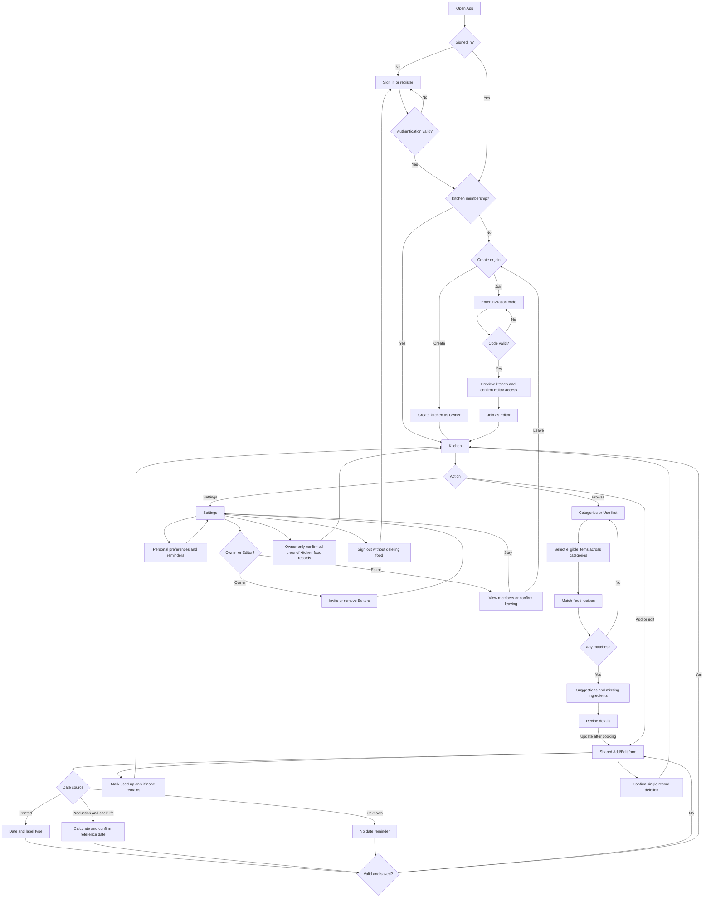

# Application workflow

Prototype 0.1 navigation. See [validation results](VALIDATION.md) for executed checks and limitations.

Rules: unknown dates remain visible; past-use-by records cannot be selected for matching; Best before is distinct; selecting/reading recipes never consumes stock; personal settings and selections are not shared; permission checks run on every backend request; failures preserve draft inputs; clear food records never deletes memberships or accounts.
