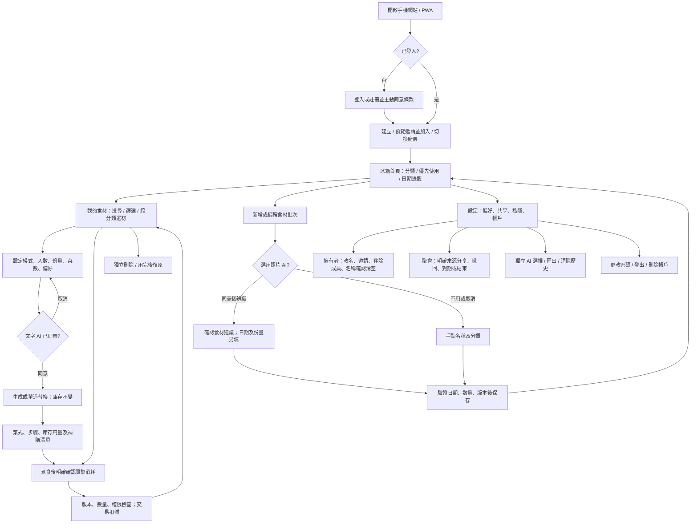

# Last Minute Bites 目前操作與畫面流程

版本 1.4.2；2026-11-15 核對。舊的固定食譜流程保存在 [歷史文件](legacy/APP_FLOW_0_1.md)，不適用於目前 App。

## 畫面與不變條件

- 首次使用：不預先勾選條款；文字與照片 AI 預設關閉，可先用手動庫存。重新確認協議不代表同意相機或通知。
- 新增／編輯：同一表單處理數量、單位、購買日、日期來源、分類與位置；未知舊數量可保持未知。
- 食譜：順序為 `stock_first`、`plan`、`use_up`。模式約束與補購限制在後端驗證，不是固定配對四個食譜。
- 消耗：輸入實際數量或按 All，再明確確認；取消不扣庫存，不能把看過食譜當作已煮食。
- 共享：角色依廚房分別判斷；跨廚房只在聚會使用已批准來源。停止分享、離開、移除或到期後立即停止來源存取。
- 設定：擁有者可改名；清空只處理目前廚房的食物紀錄，名稱不符會保留確認視窗並提醒空格。
- 私隱與帳戶：不接受新版條款仍可存取匯出／刪帳；有其他成員的自有廚房須先轉移擁有權。
- 畫面持續呈現儲存成功、錯誤、載入及空白狀態；窄屏、放大文字及鍵盤 viewport 有專門驗收。

這是開發流程說明，不是已完成的正式課程 User Guide。正式指南仍需組員整理畫面、步驟及真機證據。
