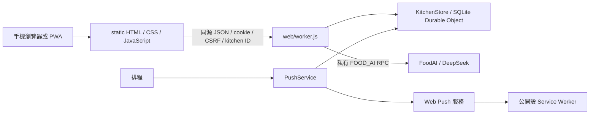

# Last Minute Bites 目前架構

適用版本：1.4.2。2026-11-15 依 `static/`、`web/` 及其測試核對。早期 Python／固定食譜架構已移至 [歷史文件](legacy/ARCHITECTURE_0_2.md)。

## 執行元件

正式入口：<https://last-minute-bites-demo.jzalx789.workers.dev/>。伺服器部署於 Cloudflare；不會在使用者手機執行 Python。`server.py`、WSGI、`recipes.json` 及其相關測試保留為早期相容／參考材料，並非目前正式後端或 AI 回應來源。

| 責任 | 程式碼 |
| --- | --- |
| 路由、表單、清單、選材、錯誤／載入狀態 | `static/app.js`、`static/index.html`、`static/style.css` |
| 相機掃碼、PWA 安裝 | `static/mobile.js` |
| 通知／公開介面快取 | `static/notifications.js`、`static/sw.js` |
| HTTP、session、CSRF、SQL、actor lock、AI 快照 | `web/worker.js` |
| 廚房成員、切換、聚會來源權限與遷移 | `web/kitchens.js` |
| 條款、可選 AI 授權、匯出及帳戶生命週期 | `web/account.js`、`web/legal.js` |
| 日期、數量、消耗、密碼雜湊 | `web/domain.js` |
| 食譜輸入／輸出驗證、模式與單道替換 | `web/ai.js` |
| 名稱分類、真實 AI RPC、推播 | `web/food-classifier.js`、`web/ai-gateway.js`、`web/push-service.js`、`web/web-push.js` |

## 主要資料實體

以目前遷移完成後的 schema 為準；原始 `SCHEMA` 及 `migrateKitchens()` 須一起閱讀。

| 實體 | 重要欄位與用途 |
| --- | --- |
| `users` | integer ID、唯一 email、PBKDF2-SHA256 密碼表示；不存明文密碼 |
| `sessions` | 雜湊 token、user ID、CSRF、到期時間、目前預設 kitchen ID |
| `kitchens` | ID、name、home/party kind、expires、ended |
| `memberships` | `(user_id, kitchen_id)` 複合主鍵、owner/editor；同帳戶可加入多個廚房 |
| `party_sources` | party ID、source ID、owner ID；借用原批次，不複製食材 |
| `invitations` | 邀請碼雜湊、kitchen ID、到期時間 |
| `food_items` | ID、kitchen ID、version、active/used、JSON 食材資料 |
| `user_preferences` | language、text size、時區、日期格式、提醒設定 JSON |
| `user_consents` | 條款版本／時間、獨立文字及照片 AI 選擇、revision |
| `mutation_keys` | 使用者／新增重試鍵、body hash、結果；避免相同新增重送重複入庫 |
| `recipe_generations`、`food_assessments` | 按帳戶與廚房隔離的食譜歷史、分類結果及時間 |
| `ai_usage` | 每日／類型／帳戶次數與站點配額 |
| `push_configuration`、`push_subscriptions`、`push_scheduler` | 推播設定、訂閱、session／kitchen 綁定、排程和每日去重 |

食材 JSON 包含名稱、分類、存放位置、quantity、unit、購買日、日期來源及標示、有效日期、備註。`null` 舊數量保持未知；不能自動猜測。食材 ID 是批次識別，不會因同名而合併。

## 一般資料流

1. `GET /api/state` 取得 session、CSRF 及目前帳戶可存取的廚房／食材；公開使用者不獲得其他帳戶資料。
2. 寫入帶 cookie、`X-CSRF-Token` 和明確的 `X-Kitchen-ID`。後端檢查角色、來源權限、版本及欄位，不信任 UI 隱藏按鈕或客戶端角色。
3. SQL 交易內完成驗證與更新；多筆消耗有任何錯誤便全數回滾。修改／消耗增加食材版本。
4. 成功後重新讀取狀態；前端每五秒及聚焦時更新共享資料，保留正在輸入的表單。這是輪詢同步，不是 WebSocket 或推送式即時資料庫。
5. 過時版本、權限失效、輸入錯誤及網絡失敗回傳具體錯誤；不顯示虛假儲存成功。

## AI 資料流

只有使用者明確生成、替換、分類或確認照片功能才可能呼叫模型。一般瀏覽、輪詢及常見名稱規則不會生成付費食譜。

文字／照片 AI 分開授權。後端建立庫存與權限快照，在短鎖之外呼叫私有 `FOOD_AI` RPC；回覆後重新核對 session、授權 revision、成員／聚會有效性、食材版本及數量。結果須通過食材 ID、模式、調味／補購與用量驗證才顯示。過期或不合規結果會拒絕，不用固定食譜冒充模型。

生成食譜不扣庫存。使用者煮食後另行確認實際消耗，才在交易內扣減原批次。照片在前端縮小，經同意送往 AI 服務，不保存為資料庫照片，也不自動入庫或推測安全性。

## 代表 API 與權限

| API | 行為／權限 |
| --- | --- |
| `register`、`login`、`logout` | 正常帳戶認證及 session 輪換；註冊要求主動同意條款 |
| `kitchen/create`、`kitchen/switch` | 建立／切換有成員權限的廚房 |
| `kitchen/rename`、`kitchen/clear` | 活躍擁有者；清空另需完整名稱確認 |
| `invitation/*`、`member/remove` | 加入須預覽及確認；邀請輪換／移除限擁有者 |
| `food/create`、`food/update`、`food/delete` | 有權的原廚房批次 CRUD；編輯／刪除借用來源須回來源廚房 |
| `food/consume`、`food/batch` | 明確確認、版本檢查及原子消耗／復原 |
| `recipes/generate`、`recipes/replace`、`recipes/history` | 按帳戶／廚房隔離；生成及替換要求 AI 授權 |
| `food/classify`、`food/recognize` | 名稱規則／模型分類與照片建議；不能自動保存食材 |
| `party/source/*`、`party/end` | 來源擁有者明確分享、立即撤回及有效期檢查 |
| `privacy`、`account/*` | 個人授權、匯出、歷史、更改密碼及刪帳；敏感操作重新認證 |
| `push/*` | 綁定已登入使用者、session 與單一廚房的訂閱 |

完整路徑、request 欄位和錯誤以程式及 `tests/*_api*.py` 為準。

## 安全、效能及限制

- HTTPS、HttpOnly／Secure／SameSite cookie、同源 Origin 檢查、CSRF、參數化 SQL 和伺服器授權。
- 全部廚房共用一個 Durable Object，隔離靠成員和來源授權檢查；不聲稱是生產級多租戶設計。
- Service Worker 只快取公開殼，不快取 API 或私人庫存；離線不能繼續登入／讀寫雲端庫存。
- AI 金鑰只在既有私有服務；原始碼包及瀏覽器不含金鑰。名稱規則、數量／日期驗證及輸入大小限制減少不必要呼叫。
- SQLite 遷移保留既有帳戶、ID、成員及食材；不可換 namespace 或清空正式資料來處理錯誤。
- 相機、AI 與通知是不同授權。推播測試傳輸／瀏覽器模擬不能證明實體手機收到通知。
- 本機測試 RPC 是 fixture；真實模型品質、真機及使用者測試須另外保留證據。
